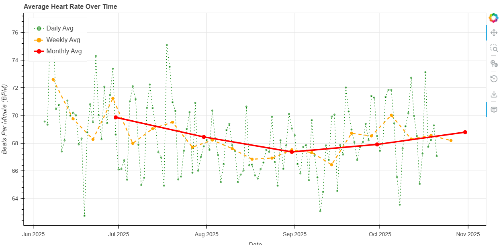

# Android Health Connect Data Explorer

A Python script to analyze your exported Android Health Connect SQLite database, focusing on heart rate data. It calculates daily, weekly, and monthly averages and can display them in the console or as a beautiful, interactive graph.



## Why?

Android's Health Connect "export data" feature gives you a raw SQLite database file, but it's not in a human-readable format. This script connects directly to that database, extracts the most useful data (your heart rate), and turns it into easy-to-understand averages.

## Features

* **Direct SQLite Connection:** Reads your `.db` export file directly.
* **Time-Series Analysis:** Parses your raw heart rate data (`heart_rate_record_series_table`).
* **Multiple Averages:** Automatically calculates daily, weekly, and monthly heart rate averages.
* **Running Sessions & Efficiency Analysis:** Automatically detects running sessions (`exercise_session_record_table`) and calculates:
    * **Efficiency Factor (EF):** $\text{Speed (m/min)} / \text{Avg BPM}$ to track aerobic economy trends over time.
    * **Aerobic Decoupling ($Pw:HR$ / Drift %):** Compares first-half vs second-half efficiency ($(1 - \text{EF}_2 / \text{EF}_1) \times 100$) with a 5% aerobic decoupling threshold.
    * **Running Cadence (SPM):** Total and split cadence (steps per minute) calculated from cadence records or step series.
    * **Stride Length (m):** Total and split stride length in meters calculated from distance and steps / cadence.
    * **Half-Split Metrics:** Heart rate, speed, cadence, stride length, and efficiency for both the first and second halves of the run.
    * Duration, distance, pace, speed, and average/max heart rate.
* **Two Output Modes:**
    * `console`: Prints clean, formatted tables of resting averages and running sessions with EF, Cardiac Drift, Cadence, and Stride Length.
    * `graph`: Generates an interactive, responsive tabbed HTML graph using [Bokeh](https://bokeh.org/) with dedicated tabs for **Heart Rate Averages** and **Running Sessions** (with synchronized time axes for EF, Cardiac Drift, Cadence, and Stride Length).
* **Data Filtering:** Use the `--max-bpm` flag to filter resting trends without affecting running session metrics, or `--no-runs` to exclude running sessions entirely.

## Installation

1.  **Clone the repository:**
    ```bash
    git clone https://github.com/verybadsoldier/android-health-connect-data-explorer.git
    cd android-health-connect-data-explorer
    ```

2.  **Create a virtual environment (Recommended):**
    ```bash
    # On macOS/Linux
    python3 -m venv venv
    source venv/bin/activate
    
    # On Windows
    python -m venv venv
    .\venv\Scripts\activate
    ```

3.  **Install the required libraries:**
    ```bash
    pip install -r requirements.txt
    ```

## Usage

You will need the path to your exported Health Connect database file (e.g., `health-connect-export.db` or `Health Connect.zip`).

### To Output Averages to the Console:

This is the default behavior.

```bash
python main.py /path/to/your/health-connect-export.db
```

Or directly with a ZIP archive:

```bash
python main.py /path/to/your/Health-Connect.zip
```

### To Generate the Interactive Graph:

This will open the graph in your default web browser.

```bash
python main.py /path/to/your/Health-Connect.zip --output graph
```

### To Filter Data:

Here's how to generate a graph that ignores any resting heart rate readings above 90 BPM.

```bash
python main.py /path/to/your/Health-Connect.zip --output graph --max-bpm 90
```

---

## Project Structure

The project follows a standard Python package layout (`src` layout) with a clean separation of concerns:

* **`main.py`**: Root entry point delegating to the `health_connect` package for backwards compatibility and ease of running directly (`python main.py ...`).
* **`src/health_connect/`**:
  * **`db.py`**: SQLite database connection, ZIP archive extraction via context manager, table inspection, and SQL data queries (`fetch_heart_rate_data`, `fetch_running_raw_data`).
  * **`analysis.py`**: Pure data analytics without DB or plotting dependencies: resting heart rate hierarchical averaging, running efficiency factor (EF), aerobic decoupling (cardiac drift), cadence fallback, stride length, and split calculations.
  * **`visualization.py`**: Presentation layer for interactive Bokeh tabbed plots (with synchronized time axes, hover tools, and data tables) and formatted console output.
  * **`cli.py`**: Command-line argument parsing and end-to-end execution pipeline.
  * **`__main__.py`**: Enables package execution (`python -m health_connect ...` or `health-connect-explorer ...`).
  * **`heart_rate.py` / `running.py`**: Topic facades for convenience.
* **`tests/`**: Unit test suite verifying metric computations, pace formatting, and database extraction using standard library `unittest`.

---

## **Important: Database Schema**

This script assumes the heart rate data is in `heart_rate_record_series_table` with the following columns:

* **Timestamp column:** `epoch_millis`
* **Heart rate column:** `beats_per_minute`

If your database export has a different structure, you will need to edit the `sql_query` variable inside the `fetch_heart_rate_data` function in `src/health_connect/db.py` to match your schema.

A helper function `inspect_table_columns` is available in `health_connect.db` to help inspect table schemas if needed.

## License

This project is licensed under the MIT License. (You can add a `LICENSE` file to your repo by clicking "Add file" > "Create new file" on your repo's main page. Type `LICENSE` as the filename and GitHub will offer you an MIT template.)
